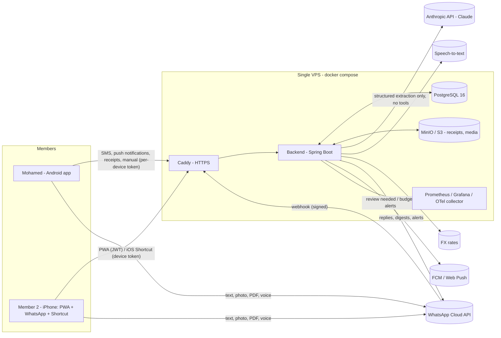
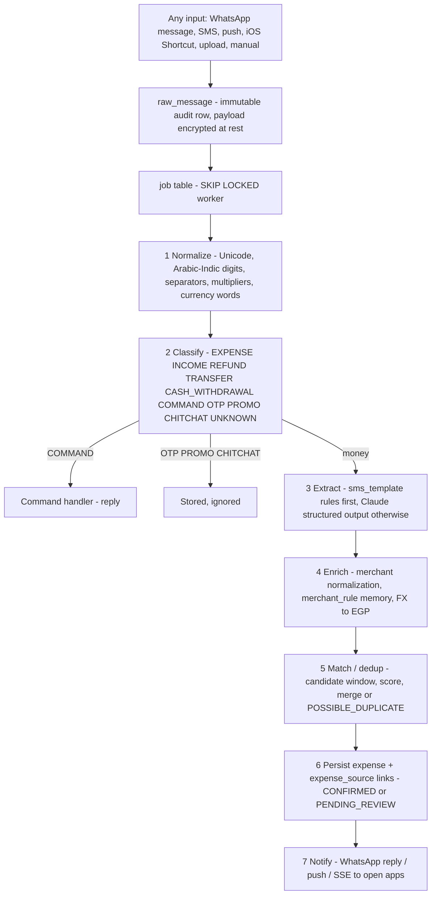
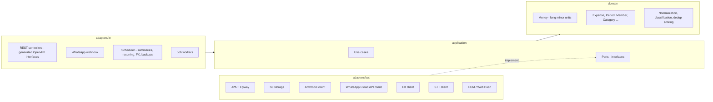
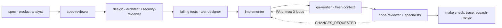

# Architecture

Living document. Phase 0 version: boundaries, flows and privacy posture that every story must respect. Module
internals are added by the `architect` agent as stories land (each significant choice has an ADR in `docs/adr/`).

## 1. System context

## 2. Ingestion pipeline (one path for every channel)

Rules that never change: rules before LLM; the LLM receives only delimited data blocks and returns schema-validated
JSON (one repair retry, then `NEEDS_REVIEW`); server-side bounds force `PENDING_REVIEW` for amounts above the ceiling,
INCOME from WhatsApp text, or unknown categories; every call is logged in `ai_call_log` with prompt version and cost.

## 3. Backend layout (hexagonal)

Dependency rule (ArchUnit-enforced): domain imports nothing from Spring, JPA, Jackson or HTTP; adapters depend inward
only and never on each other; no `double`/`float` in money, parsing, dedup or analytics types.

## 4. Data flows and privacy

| data | where it lives | protection |
|---|---|---|
| SMS / WhatsApp text, OCR text | `raw_message.text`, `media.ocr_text` (Postgres) | AES-GCM encrypted at rest (`APP_ENCRYPTION_KEY`); never logged above DEBUG; only the parsing-relevant text goes to the LLM, with balances and account numbers stripped where not needed |
| receipt images, PDFs, voice notes | MinIO/S3 bucket | server-side encryption; keys referenced from `media`; perceptual hash for dedup |
| phone numbers, WhatsApp ids | `member`, `raw_message.sender` | masked in logs; anonymized range in fixtures |
| card / account numbers | only last-4 in `payment_account.last4` | full numbers are never stored; masked in prompts |
| OTPs | never leave the phone | dropped on-device by the Android filter (hard test gate) |
| secrets | `.env` on the VPS, GitHub Actions secrets | never in git (gitleaks, scan-secrets hook) |
| backups | encrypted nightly dumps + media sync | weekly automated restore test |

Trust boundaries and STRIDE analysis: `docs/security/THREAT_MODEL.md`.

## 5. Clients

- **Web PWA** (iPhone home screen + desktop): generated TypeScript client, TanStack Query cache, SSE for live updates, IndexedDB outbox for offline manual entries, web push.
- **Android**: generated Kotlin client, Room cache + outbox with backoff, WorkManager for SMS/notification processing, Glance widget, share target, biometric lock.
- Both render analytics computed by the backend (Cairo timezone, household month start day).

## 6. The SDLC around the system

Deterministic guardrails: hooks in `.claude/hooks` (tested in `.claude/hooks/tests`), lefthook git hooks, CI workflows in `.github/workflows`, eval harness in `eval/`, traceability in `docs/TRACEABILITY.md`.
