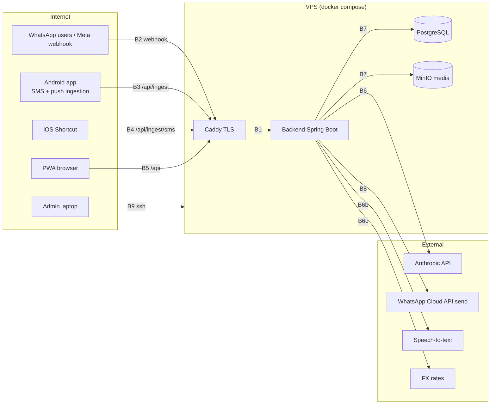

# Threat model — Masroof

Owner: `security-reviewer` (upkeep at every story that touches auth, ingestion, PII or LLM prompts; S2 stage 3).
Method: STRIDE per trust boundary. Status values: `Planned` (REQ defined, no story yet), `In progress (STORY-xxx)`, `Done (STORY-xxx)`, `Accepted risk (ADR-xxxx)`.
Last reviewed: Phase 0 (skeleton). Checklists that reference these REQ IDs: `ASVS_CHECKLIST.md`, `MASVS_CHECKLIST.md`, `LLM_SECURITY.md`.

## 1. System and trust boundaries

| Id | Boundary | Protocol / auth |
|---|---|---|
| B1 | Internet -> Caddy -> backend | HTTPS (Caddy ACME), HSTS; backend only reachable on the compose network |
| B2 | Meta webhook -> backend `/webhooks/whatsapp` | HTTPS; `X-Hub-Signature-256` HMAC with `WHATSAPP_APP_SECRET`; GET handshake with `WHATSAPP_VERIFY_TOKEN` |
| B3 | Android app -> `/api/ingest/*`, `/api/*` | HTTPS + certificate pinning; per-device ingestion token (hashed in DB) + member JWT |
| B4 | iOS Shortcut -> `/api/ingest/sms`, `/api/ingest/receipt` | HTTPS; per-device token header; no interactive auth possible |
| B5 | PWA -> `/api/*` | HTTPS; short-lived JWT access + rotating refresh token; CORS locked to `WEB_BASE_URL` |
| B6 | backend -> Anthropic API (and B6b STT, B6c FX) | HTTPS, API key from env; outbound only |
| B7 | backend -> PostgreSQL / MinIO | compose-internal network; DB user with least privilege; MinIO access key per bucket. JDBC to Postgres must use `sslmode=verify-full` with `channelBinding=require` (SCRAM-SHA-256) once the DB is not on a private socket/network; the Flyway migration user is a separate, DDL-capable role used only at deploy time, the runtime role has no DDL (STORY-002 uses one local dev user) |
| B8 | backend -> WhatsApp Cloud API (send) | HTTPS, permanent system-user token; only to the household group / member numbers |
| B9 | admin -> VPS | SSH key only; `/release` skill + `MASROOF_RELEASE_ACTIVE` flag; CI deploy user |

## 2. Assets

| Asset | Sensitivity | Where | Protection (REQ) |
|---|---|---|---|
| Raw bank SMS / WhatsApp texts / OCR text (`raw_message`) | High (financial PII, balances, last-4) | Postgres | REQ-SEC-005, -006, -007, -009 |
| Receipt images and voice notes | High | MinIO | REQ-SEC-008 |
| Expenses, budgets, analytics | Medium (household finances) | Postgres | REQ-SEC-023, -007 |
| Member phone numbers, device ids | Medium (PII) | Postgres | REQ-SEC-006, -025 |
| Secrets: `APP_ENCRYPTION_KEY`, `JWT_SECRET`, `WHATSAPP_*`, `ANTHROPIC_API_KEY`, DB/MinIO creds | Critical | VPS `.env`, GitHub secrets | REQ-SEC-021, -027, -013 (gitleaks) |
| Per-device ingestion tokens | High (lets anyone inject transactions) | hashed in Postgres; plaintext only on device | REQ-SEC-003, -014 |
| Android release keystore, cosign key | Critical (supply chain) | GitHub secrets + owner's password manager | REQ-SEC-028 |
| Backups | High | encrypted in `BACKUP_S3_BUCKET` | REQ-SEC-012 |
| LLM prompts and eval datasets | Low-Medium (anonymized) | repo | S10, anonymize-fixtures.py |

## 3. STRIDE per boundary

Legend: **S**poofing, **T**ampering, **R**epudiation, **I**nformation disclosure, **D**enial of service, **E**levation of privilege.

### B1 Internet -> Caddy -> backend

| STRIDE | Threat | Mitigation | REQ | Status |
|---|---|---|---|---|
| S | Phishing clone of the PWA domain | HSTS preload, only one canonical domain, PWA installed from it | REQ-SEC-001 | Planned |
| T | TLS downgrade / MITM | TLS 1.2+ only, Caddy defaults, HSTS `max-age>=1y` | REQ-SEC-001 | Planned |
| I | Verbose errors, stack traces, server headers | Problem+JSON errors without internals; Caddy strips `Server`; security headers (CSP, X-Content-Type-Options, Referrer-Policy) | REQ-SEC-001 | Planned |
| D | Request floods, slowloris, oversized bodies | Caddy rate limit per IP on `/api/ingest/*` and `/webhooks/*`; body size limits (text 64 KB, media 10 MB); timeouts | REQ-SEC-004 | Planned |
| E | Direct access to backend/Postgres/MinIO ports | Only Caddy publishes ports; `ufw` default deny; compose internal network | REQ-SEC-020, REQ-SEC-021 | Planned |

### B1a compose network / loopback -> backend `GET /health` (STORY-143)

In STORY-143 the endpoint is reachable only from the compose network and, through the dev-only overlay, on
`127.0.0.1:8080`. The base compose publishes no port. Internet exposure through Caddy arrives with STORY-142.

| STRIDE | Threat | Mitigation | REQ | Status |
|---|---|---|---|---|
| S | Anyone calls `/health` | Unauthenticated by design; no state, no household data | — | Accepted (DECISIONS 2026-10-23) |
| T | Query parameters or headers change the response (reflection, content-type confusion) | Nothing is bound from the request; Content-Type is preset, so Accept is ignored; tests cover a 2,000-character query and XML/HTML Accept | REQ-SEC-001 | In progress (STORY-143) |
| I | `version`, `gitSha`, `buildTime` disclosed | Accepted for the owner's private deployment | — | Accepted (DECISIONS 2026-10-23) |
| I | DB-down response leaks a JDBC URL, host:port, credentials or a stack trace | Fixed Problem body (`Database unavailable`); the probe catches everything and logs only the exception class name; tests apply the leak regex to body and headers | REQ-SEC-001 | In progress (STORY-143) |
| D | `/health` floods turn into DB load, or hang threads while Postgres is unreachable | One `isValid` per call under a 2 s hard deadline; Hikari pool (10), `connection-timeout` 2 s, pgjdbc `connectTimeout` 2 s; per-IP rate limit (healthcheck exempt) | REQ-SEC-051 | In progress (STORY-143: bounds); Planned (STORY-010: rate limit) |
| E | Container compromise escalates, or actuator exposes internals | Non-root uid 10001, `read_only` root FS + `/tmp` tmpfs, `cap_drop: ALL`, `no-new-privileges`; actuator not on the classpath (STORY-003 adds it, internal only) | REQ-SEC-020 | In progress (STORY-143) |

### B2 Meta webhook -> backend

| STRIDE | Threat | Mitigation | REQ | Status |
|---|---|---|---|---|
| S | Forged webhook posts fake expenses or commands | Verify `X-Hub-Signature-256` (HMAC-SHA256 over raw body with app secret, constant-time compare) before parsing; reject unsigned | REQ-SEC-002 | Planned |
| S | Bogus GET handshake re-points the subscription | Compare `hub.verify_token` constant-time; log attempts | REQ-SEC-002 | Planned |
| T | Replayed or duplicated messages | Idempotency on WhatsApp message id (`raw_message` unique); `expense_source` dedup (Section 7) | REQ-SEC-002 | Planned |
| R | "I never sent that" disputes | Immutable `raw_message` audit trail with sender id + timestamps; edit history on expenses | REQ-SEC-024 | Planned |
| I | Messages from strangers who join the group | Only household member numbers are processed; others get no reply and are logged as `IGNORED_SENDER` | REQ-SEC-030 | Planned |
| D | Webhook storm delays ack beyond Meta's timeout | Ack `200` in <1 s (S9), enqueue to the DB job table, process async; rate limit | REQ-SEC-004 | Planned |
| E | Chat command ("edit last", "delete") run on another member's entry | Commands are authorised per sender number; destructive commands need confirmation reply | REQ-SEC-023 | Planned |

### B3 Android app -> ingest API

| STRIDE | Threat | Mitigation | REQ | Status |
|---|---|---|---|---|
| S | Stolen device token injects fake SMS | Token bound to device id, hashed (SHA-256 + pepper) in DB, revocable from Settings and by admin instantly | REQ-SEC-003, REQ-SEC-014 | Planned |
| S | Rogue Wi-Fi MITM | Certificate pinning to our domain with a backup pin; network security config HTTPS-only | REQ-SEC-017 | Planned |
| T | Modified APK (sideloaded) | APK signed with the release keystore; in-app update verifies SHA-256 from `/api/app/android/latest` | REQ-SEC-028 | Planned |
| I | OTPs or non-financial SMS uploaded | Sender allowlist on device; OTP/verification patterns dropped on device and never persisted | REQ-SEC-018 | Planned |
| I | SMS bodies in backend logs | Structured logging with redaction; semgrep rule `masroof-no-log-message-content-*`; never at INFO | REQ-SEC-005 | Planned (semgrep rule: Done) |
| I | Account numbers stored/shown in full | Mask to last-4 at parse time; raw text encrypted (AES-GCM) at rest | REQ-SEC-006, REQ-SEC-007 | Planned |
| D | Backfill of 90 days floods the API | Batch endpoint with per-device rate limit; outbox retry with backoff | REQ-SEC-004 | Planned |
| E | Device token used for non-ingest endpoints | Ingest tokens scoped to `/api/ingest/*` only; member JWT needed elsewhere | REQ-SEC-003 | Planned |

### B4 iOS Shortcut -> ingest API

| STRIDE | Threat | Mitigation | REQ | Status |
|---|---|---|---|---|
| S | Token leaks via screenshot of the Shortcut | Token shown once; revocable; per-device; rotate from Settings | REQ-SEC-003, REQ-SEC-014 | Planned |
| T | Shortcut forwards edited text | Treated like any message: parsed, bounded, `PENDING_REVIEW` when low confidence | REQ-SEC-011 | Planned |
| I | Shortcut matches too broadly and forwards OTPs | Setup doc configures sender + keyword filters; server-side OTP classifier drops and never stores body | REQ-SEC-018 | Planned |
| D | Automation loop re-sends | Idempotency on `(device_id, sms_id/hash)` | REQ-SEC-002 | Planned |

### B5 PWA -> API

| STRIDE | Threat | Mitigation | REQ | Status |
|---|---|---|---|---|
| S | Session theft (XSS, token in localStorage) | Access JWT 15 min in memory; refresh token in `HttpOnly; Secure; SameSite=Strict` cookie with rotation + reuse detection | REQ-SEC-015 | Planned |
| S | CSRF on cookie-based refresh | SameSite=Strict + Origin check; CORS allowlist = `WEB_BASE_URL` only | REQ-SEC-016 | Planned |
| T | IDOR: member A edits household B's expense | Every repository query scoped by `household_id` from the token; ArchUnit rule + integration tests with two households | REQ-SEC-023 | Planned |
| I | XSS via merchant names / notes from WhatsApp | React escaping, strict CSP (no inline scripts), DOMPurify for any rich text | REQ-SEC-001 | Planned |
| I | Receipt images via guessable URLs | Presigned MinIO URLs, 5-minute expiry, scoped per object | REQ-SEC-008 | Planned |
| D | Export endpoint abuse | Rate limit + async job for full export | REQ-SEC-004, REQ-SEC-025 | Planned |
| E | Member escalates to admin | Role claims in JWT verified server-side; admin-only endpoints under `/api/admin/**` with method security | REQ-SEC-023 | Planned |

### B6 backend -> Anthropic API (and STT / FX)

| STRIDE | Threat | Mitigation | REQ | Status |
|---|---|---|---|---|
| S | Prompt injection: message text instructs the model | Data wrapped in delimited blocks; system prompt states content is data; no side-effect tools; adversarial eval suite gates prompt changes (S10.5) | REQ-SEC-010 | Planned |
| T | Model returns out-of-range amounts, INCOME from WhatsApp text, unknown categories | JSON schema validation; server-side bounds (`AI_AMOUNT_CEILING_EGP`), forced `PENDING_REVIEW` | REQ-SEC-011 | Planned |
| I | Balances, account numbers, phone numbers sent to the LLM | Minimization: strip balances/account numbers/phone numbers before prompting; only fields parsing needs | REQ-SEC-009 | Planned |
| I | API key leak | Key only in backend env; never in clients; gitleaks + hook `scan-secrets.sh` | REQ-SEC-027, REQ-SEC-013 | Planned (scanners: Done) |
| D | Cost blow-up (long voice notes, image spam, retries) | Per-household daily token budget, max image size, 1 retry, `AI_MONTHLY_BUDGET_USD` alert | REQ-SEC-022 | Planned |
| R | Which prompt version produced an entry | Store prompt version + model + token counts per `raw_message` | REQ-SEC-024 | Planned |

### B7 backend -> PostgreSQL / MinIO

| STRIDE | Threat | Mitigation | REQ | Status |
|---|---|---|---|---|
| T | SQL injection | JPA/parameterised queries only; semgrep `masroof-no-string-concat-sql`; SpotBugs | REQ-SEC-023 | Planned (semgrep rule: Done) |
| I | DB dump or disk theft exposes texts | `raw_message.text`, OCR text encrypted with `APP_ENCRYPTION_KEY` (AES-GCM, key outside DB); MinIO SSE | REQ-SEC-007, REQ-SEC-008 | Planned |
| I | Backups readable | `age`-encrypted dumps; bucket private | REQ-SEC-012 | Planned |
| D | Disk full, runaway media | Disk alert at 80 %, media size caps, retention for raw media (configurable) | REQ-SEC-022 | Planned |
| D | DB outage or hang blocks request threads indefinitely | Hikari `connection-timeout` 2000 ms, `validation-timeout` 1000 ms, pgjdbc `connectTimeout` 2 s; the health probe has a hard 2 s deadline | REQ-SEC-022 | In progress (STORY-143) |
| E | App DB user owns everything | Separate migration role (Flyway) and runtime role without DDL | REQ-SEC-020 | Planned |
| S | Network peer impersonates Postgres or downgrades auth (no channel binding) | `sslmode=verify-full` + `channelBinding=require` in the production JDBC URL; SCRAM-SHA-256 only; prod profile requires `POSTGRES_PASSWORD` (no empty default) | REQ-SEC-020 | Planned (prod password guard: Done STORY-002) |

### B8 backend -> WhatsApp send

| STRIDE | Threat | Mitigation | REQ | Status |
|---|---|---|---|---|
| S | Backend sends to arbitrary numbers (bug or injection) | Recipient allowlist = household group id + member numbers; template-based replies | REQ-SEC-030 | Planned |
| I | Reply leaks another member's data in the group | Replies contain only the entry being confirmed; summaries are household-level by design (shared finances) | REQ-SEC-030 | Planned |
| D | Token revoked / rate limited by Meta | Outbox with retry + alert; alerts also by email (S13) | REQ-SEC-029 | Planned |
| I | Access token leak | Env only; rotation runbook; gitleaks | REQ-SEC-027 | Planned |

### B9 admin -> VPS

| STRIDE | Threat | Mitigation | REQ | Status |
|---|---|---|---|---|
| S | SSH brute force | Key-only auth, root login disabled, fail2ban, non-standard user | REQ-SEC-021 | Planned |
| T | Compromised CI deploys a malicious image | Images built in CI from `main`/tags only, cosign-signed, Trivy-scanned; deploy pulls by tag from GHCR; branch protection + required `gate` check | REQ-SEC-013, REQ-SEC-020 | Planned (workflows: Done) |
| T | Agent runs a destructive command against prod | `guard-bash.sh` blocks `PROD_HOST` commands unless `MASROOF_RELEASE_ACTIVE`; `permissions.deny` rules | REQ-SEC-021 | Planned (hooks: Phase 0) |
| R | Who deployed what | GitHub environment `production` with deployment history; `infra/.deployed/*.env` with timestamps | REQ-SEC-024 | Planned |
| I | `.env` readable by other users | `chmod 600`, owner `masroof`; no secrets in images | REQ-SEC-021 | Planned |
| D | Failed deploy leaves prod down | Pre-deploy backup, smoke test, automatic `make rollback` | REQ-SEC-012 | Done (release.yml; scripts stub) |

### Build supply chain (backend, STORY-002)

Not a runtime boundary; it protects the artifact that crosses B1-B9.

| STRIDE | Threat | Mitigation | REQ | Status |
|---|---|---|---|---|
| T | Vulnerable transitive dependency ships in the runtime image (CWE-1395) | Spring Boot 4.1.2 BOM (OSS-supported, ADR-0004) replaces the STORY-002 overrides above the 3.5.16 BOM; an override comes back only for a finding, with a reason comment; `osv-scanner scan source -r --no-ignore backend` reports 0 findings; Dependabot | REQ-SEC-013 | Done (STORY-002); re-validated in STORY-143 |
| T | Unpinned or drifting base image in the backend image or compose | `eclipse-temurin` JDK/JRE and `postgres:16.15-alpine3.24` pinned by exact tag + multi-arch digest; Dependabot `docker` for `/backend` (`docker-compose` ecosystem for `/infra`: follow-up); Trivy image scan in main.yml | REQ-SEC-013, REQ-SEC-020 | In progress (STORY-143) |
| T | Image built from the wrong or unknown source revision | Docker build fails unless build arg `GIT_SHA` matches `^[0-9a-f]{7,40}$`; `/health` reports it; never `unknown` | REQ-SEC-013 | In progress (STORY-143) |
| I | Secrets (`.env`) or `.git` copied into the build context or image | Root `.dockerignore` is a whitelist (`backend/` only); compose passes an explicit env list, never `env_file: .env` | REQ-SEC-021, REQ-SEC-027 | In progress (STORY-143) |
| T | Tampered artifact fetched during the image build | The Docker build runs the same Gradle wrapper (`distributionSha256Sum`) and `verification-metadata.xml`, regenerated to cover `bootJar`/`bootBuildInfo` | REQ-SEC-013 | In progress (STORY-143) |
| T | Dependency graph invisible to SCA or silently changing (CWE-1104) | `dependencyLocking { lockAllConfigurations() }` -> `backend/gradle.lockfile` and `buildscript-gradle.lockfile` committed | REQ-SEC-013 | Done (STORY-002) |
| T | Tampered artifact or wrapper fetched at build time | `gradle/verification-metadata.xml` (sha256) and `gradle/actions/wrapper-validation@v4` in the backend CI jobs | REQ-SEC-013 | Done (STORY-002) |
| T | Testcontainers image tag drifts under tests | Test database image pinned to `postgres:16.15-alpine3.24@sha256:f461…` (same pin as compose) | REQ-SEC-013 | Done (STORY-002, tag); digest In progress (STORY-143) |

## 4. Requirement register (REQ-SEC)

| REQ | One-line requirement | Boundaries | Verification |
|---|---|---|---|
| REQ-SEC-001 | HTTPS only, HSTS, security headers, no internals in errors | B1, B5 | ZAP baseline, Caddy config test |
| REQ-SEC-002 | Webhook signature + verify-token checks; idempotent message ids | B2, B4 | Integration tests with recorded payloads |
| REQ-SEC-003 | Per-device ingest tokens, hashed, scoped to `/api/ingest/*`, revocable | B3, B4 | Integration + authz tests |
| REQ-SEC-004 | Rate limits and body limits on ingest/webhook endpoints | B1-B5 | k6 + Caddy tests |
| REQ-SEC-005 | Never log message bodies/OCR/payloads; redaction in JSON logs | B3, B6, B7 | semgrep rules, log assertion tests |
| REQ-SEC-006 | Mask account numbers except last-4 | B3 | Unit tests |
| REQ-SEC-007 | Encrypt sensitive columns at rest (AES-GCM, app key) | B7 | Integration test reads raw column |
| REQ-SEC-008 | Media: SSE, presigned short-lived URLs, type/size validation | B5, B7 | Integration tests |
| REQ-SEC-009 | LLM data minimization | B6 | Unit tests on prompt builder |
| REQ-SEC-010 | Prompt-injection defenses (delimited data, no side-effect tools) | B6 | Adversarial eval suite |
| REQ-SEC-011 | Server-side bounds on LLM output | B6 | Unit + eval |
| REQ-SEC-012 | Encrypted nightly backups + weekly restore test; pre-deploy backup | B7, B9 | Cron logs, restore-test report |
| REQ-SEC-013 | SAST/SCA/secret/image scanning in CI | B9 | pr.yml, main.yml, nightly.yml |
| REQ-SEC-014 | Admin removes member/device instantly (token revocation) | B3, B4 | Integration tests |
| REQ-SEC-015 | JWT 15 min + rotating refresh with reuse detection | B5 | Integration tests |
| REQ-SEC-016 | CORS locked to our origins | B5 | Integration tests |
| REQ-SEC-017 | Android: allowBackup=false, HTTPS-only NSC, pinning, no unprotected exported components | B3 | semgrep rule, MobSF, Android Lint |
| REQ-SEC-018 | SMS allowlist on device; OTPs dropped on device | B3, B4 | Unit tests, Maestro |
| REQ-SEC-019 | Money never floating point | all | ArchUnit, detekt, semgrep, ESLint |
| REQ-SEC-020 | Non-root, read-only containers; least-privilege DB roles | B1, B7, B9 | Trivy misconfig, compose review |
| REQ-SEC-021 | VPS hardening; secrets `600`; prod commands only via release flow | B9 | Checklist in DEPLOY.md, hook tests |
| REQ-SEC-022 | LLM/STT budgets, size caps, disk alerts | B6, B7 | Unit tests, alert rules |
| REQ-SEC-023 | Household-scoped authorization everywhere; parameterised SQL | B2, B5, B7 | ArchUnit, two-household integration tests |
| REQ-SEC-024 | Audit trail: raw messages immutable, edit history, prompt version per entry | B2, B6, B9 | Integration tests |
| REQ-SEC-025 | Full data export and deletion for the household | B5 | e2e |
| REQ-SEC-026 | Upload validation: MIME sniffing, size caps, image re-encode | B3, B5 | Integration tests |
| REQ-SEC-027 | Third-party API keys only on the backend | B6, B8 | gitleaks, code review |
| REQ-SEC-028 | Signed APK; in-app update verified by SHA-256 | B3 | release.yml, Maestro |
| REQ-SEC-029 | Alerts on signature failures, parse failures, job lag, LLM errors | B2, B6 | Alert rule tests |
| REQ-SEC-030 | WhatsApp send only to allowlisted recipients | B8 | Unit tests |

## 5. Out of scope / accepted for now

- Native iOS app: not built (Section 2); the PWA inherits browser sandboxing.
- Multi-tenant SaaS threats: one household per deployment is the target; `household_id` scoping is still enforced to keep the option open.
- Hardware wallet / banking credential storage: Masroof never holds bank credentials.
- Build supply chain: artifact signature verification (`verify-signatures`) is off in `verification-metadata.xml` (sha256 only), and no SBOM is generated for the backend yet; revisit at the first release story. Image digests are pinned from STORY-143 on.
- Framework support window: Spring Boot 3.5.16 (OSS support ended 2026-06-30) was accepted for STORY-002 only, which had no network surface. STORY-143 replaces it with 4.1.2 before the first endpoint ships (ADR-0004). If ADR-0004's fallback triggers, this becomes "Accepted risk (ADR-0003)" with manual tracking of Spring advisories.

TODO(owner): confirm the VPS provider's disk-encryption and snapshot policy; decide whether raw media retention is 90 days or indefinite.
